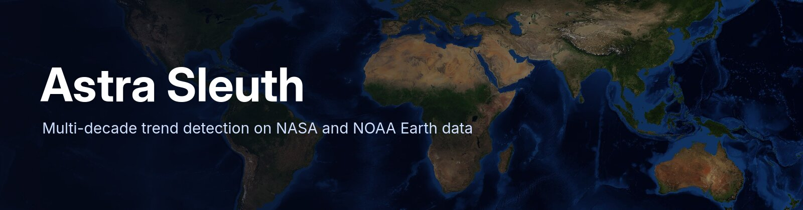
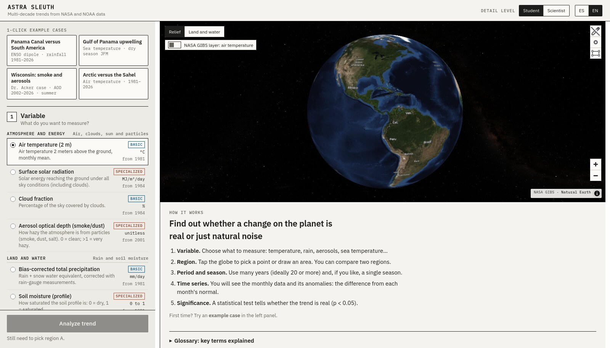
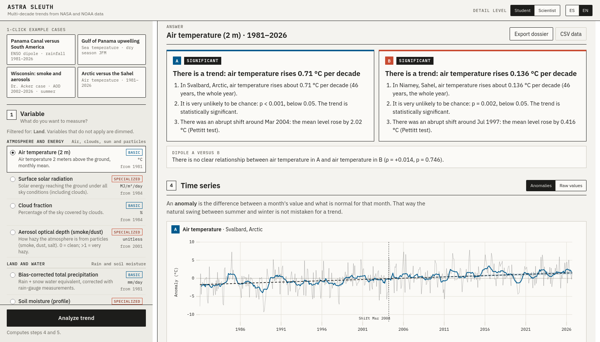

<p align="center">
  
</p>

<p align="center">
  
  
  
  
  
  <br>
  
  
  
  
</p>

Astra Sleuth answers one question: **is a change in an Earth variable a real trend, or just natural variability?**

Pick a variable, click a point or draw a box on the globe, choose a period and a season. The app pulls 20 to 45 years of monthly satellite and reanalysis data, removes the seasonal cycle, and runs a Mann-Kendall test with autocorrelation correction. You get a plain-language verdict, the rate of change per decade, the p-value, and the date of any abrupt shift.

Everything runs in the browser. There is no backend and no API key. The statistics engine is written in Rust and compiled to WebAssembly.

<p align="center">
  
  
</p>

## Goal

Long environmental records are noisy. A warm decade, a wet season, or a single El Niño can look like a trend on a chart. Astra Sleuth puts a significance test behind the chart so students, teachers and researchers can tell the difference, and explains the result at two levels: **Student** and **Scientist**.

It was built for the NASA Challenge 2026.

## Features

- 3D globe (MapLibre, globe projection) with NASA GIBS base layers and a monthly context layer for each variable.
- Point or area selection. Compare two regions side by side (dipole mode) and test whether they move together.
- Whole-year or seasonal analysis (DJF, JFM, MAM, JJA, SON).
- Anomaly and raw-value time series with the Sen trend line and the detected change point.
- Four one-click example cases: ENSO rainfall dipole (Panama Canal vs. northern Peru), Gulf of Panama upwelling, Wisconsin wildfire smoke, Arctic vs. Sahel warming.
- CSV import for NASA Giovanni "Time Series, Area-Averaged" exports and any date/value file. Daily data is averaged to monthly.
- Export a self-contained HTML dossier (text, figures, numbers), plus CSV and JSON.
- Interface in English and Spanish.

## Data sources

| Variable | Source | Product | From |
|---|---|---|---|
| Air temperature (2 m) | [NASA POWER](https://power.larc.nasa.gov/) | `T2M` | 1981 |
| Surface solar radiation | NASA POWER | `ALLSKY_SFC_SW_DWN` | 1984 |
| Cloud fraction | NASA POWER | `CLOUD_AMT` | 1984 |
| Bias-corrected precipitation | NASA POWER | `PRECTOTCORR` | 1981 |
| Soil moisture (profile) | NASA POWER | `GWETPROF` | 1981 |
| Wind speed (2 m) | NASA POWER | `WS2M` | 1981 |
| Aerosol optical depth | NASA POWER (MERRA-2) | `AOD_55` | 2001 |
| Aerosol optical depth | [NASA Giovanni](https://giovanni.gsfc.nasa.gov/) (CSV import) | MODIS-Aqua `MYD08_M3` | 2002 |
| Sea surface temperature | [NOAA OceanWatch ERDDAP](https://oceanwatch.pifsc.noaa.gov/erddap/) | Coral Reef Watch CoralTemp v3.1 (0.05°) | 1985 |
| Sea surface temperature (mirror) | [NOAA CoastWatch ERDDAP](https://coastwatch.pfeg.noaa.gov/erddap/) | NASA JPL MUR SST v4.1 (0.01°) | 2002 |
| Chlorophyll-a | [NOAA PolarWatch ERDDAP](https://polarwatch.noaa.gov/erddap/) | VIIRS S-NPP monthly | 2012 |
| Chlorophyll-a (historical) | NOAA CoastWatch ERDDAP | MODIS-Aqua monthly | 2003 to 2022 |

Map imagery comes from [NASA GIBS](https://www.earthdata.nasa.gov/engage/open-data-services-software/earthdata-developer-portal/gibs-api) (Blue Marble, MERRA-2, CERES, GLDAS, MODIS, MUR, VIIRS layers). Country borders come from [Natural Earth](https://www.naturalearthdata.com/) via `world-atlas`.

The full variable catalog, including dataset IDs, mirrors and known sensor issues, is in [`variables.json`](variables.json).

ERDDAP requests are split into 5-year chunks and sent in parallel with timeouts and retries. If one server fails, the app tries the mirror.

## Statistical methods

The engine lives in [`engine/`](engine) and has no dependencies outside the standard library (the `trend_wasm` crate adds `wasm-bindgen` and `serde`).

| Method | Use |
|---|---|
| Mann-Kendall with tie correction | Trend detection |
| Hamed and Rao (1998) | Variance correction for autocorrelated series |
| Seasonal Mann-Kendall (Hirsch et al., 1982) | Compares January with January, February with February |
| Sen's slope with confidence interval | Rate of change |
| Pettitt (1979) | Date of an abrupt shift in the mean |
| Spearman rank correlation | Relationship between two regions or two variables |
| Benjamini-Hochberg | False discovery rate across many tests (grid cells) |
| Weatherhead et al. (1998) | Years of data needed to detect a trend of a given size |

Anomalies are computed against a monthly climatology before testing.

## Getting started

Requirements:

- Node.js `^20.19` or `>=22.12`
- Rust 1.85+ via [rustup](https://rustup.rs/) (only needed to rebuild the engine)

```sh
git clone https://github.com/ArlandBarrera/astra-sleuth.git
cd astra-sleuth
npm install
npm run dev
```

Open `http://localhost:5173`.

The compiled WebAssembly is committed in `src/wasm/pkg`, so `npm run dev` works without Rust.

### Scripts

| Command | What it does |
|---|---|
| `npm run dev` | Development server |
| `npm run build` | Compile the Rust engine to WASM, type-check, build the site into `dist/` |
| `npm run build:web` | Type-check and build the site only, using the committed WASM |
| `npm run wasm` | Rebuild the WASM engine only |
| `npm run preview` | Serve the production build |
| `npm run test:engine` | Run the Rust test suite |

`npm run wasm` installs the `wasm32-unknown-unknown` target and the `wasm-bindgen-cli` version pinned in `engine/Cargo.lock` if they are missing.

## Project layout

```
engine/
  mann_kendall/   Rust library: MK, Hamed-Rao, seasonal MK, Sen, Pettitt, BH
  trend_wasm/     wasm-bindgen bridge: analysis pipeline, correlation, power estimate
src/
  data/           NASA POWER, ERDDAP and CSV loaders, monthly series handling
  engine/         Web Worker that runs the WASM engine
  ui/             Globe, side panel, charts, results, dossier export
  wasm/pkg/       Compiled engine (generated)
variables.json    Variable catalog and data source definitions
scripts/          WASM build script
```

## Credits

Data and imagery: NASA POWER, NASA GIBS, NASA Giovanni, NOAA CoastWatch, NOAA OceanWatch, NOAA PolarWatch, NOAA Coral Reef Watch, NASA JPL. Use of these data does not imply endorsement by NASA or NOAA.

Banner image built from the NASA GIBS `BlueMarble_ShadedRelief_Bathymetry` layer.
